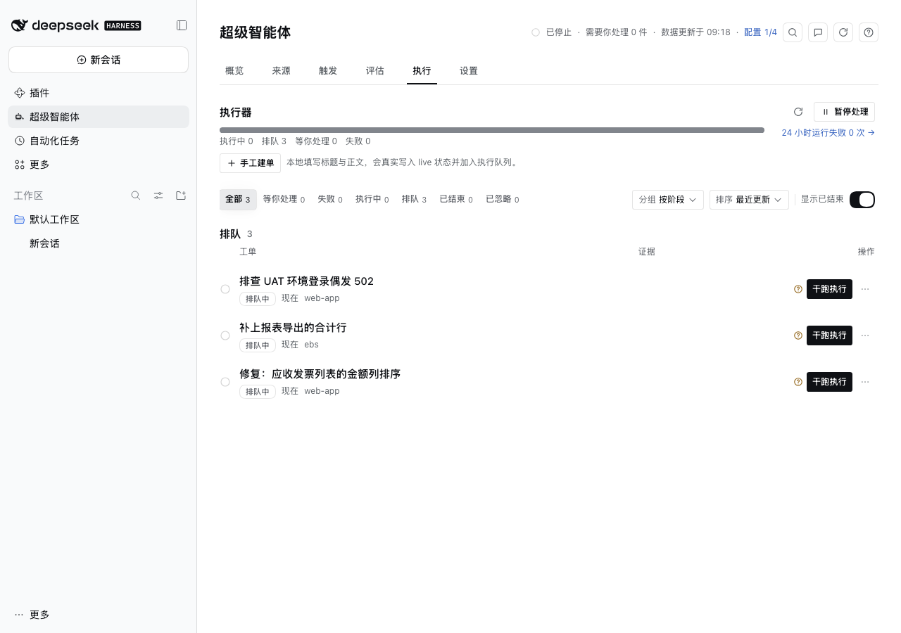

# dsh-superagent-panel

[](https://github.com/mystic7c/dsh-superagent-panel/actions/workflows/ci.yml)
[](LICENSE)
[](package.json)

> DeepSeek Harness 插件：在 Web UI 里管理主动型编码智能体（Superagent）——从群消息接单，到执行、闸门、验收与发布。



Superagent 的循环（读消息 → 判是否接单 → 开 worktree 干活 → 跑闸门 → 发 MR → 等人验收）散落在命令行、
聊天记录和一堆台账文件里。这个面板把它收进一个页面：哪个请求被接了、为什么被忽略、哪一步卡住了、接下来该谁动手。

## 功能

- **六个页签**：概览（待办 / 系统问题 / 24 小时漏斗 / 运行质量）、来源（消息与原始信号）、触发（评估过程）、
  评估（决定与规则命中）、执行（队列与工单详情）、设置。逐页说明见 [docs/pages.md](docs/pages.md)。
- **可回放**：每条群消息的判定都留在台账里，可重放、可人工标注正确/误报/漏报。
- **可干预**：闸门失败停在「等人放行」，运行中可停止，中断可继续，worker 提问可回答。
- **可配置**：来源、执行器、多后端 worker 路由、写权限、仓库与闸门，全部在设置页里改，保存前看差异，自动留快照。

## 安装

前置：DeepSeek Harness（含 Web UI）、Node.js ≥ 22。

从 [Releases](https://github.com/mystic7c/dsh-superagent-panel/releases) 下载最新 tarball：

```bash
dsh plugin --profile desktop add "file:/path/to/mystic7c-dsh-superagent-panel-<version>.tgz"
```

也可以直接装本地 checkout（以 `link:` 方式安装，改源码即时可见）：

```bash
dsh plugin --profile desktop add /path/to/dsh-superagent-panel
```

装好后左侧栏出现「超级智能体」入口。首次打开是空状态，按下面的快速开始配置。

## 快速开始

1. 设置 → 来源：保存 Octo token。
2. 设置 → 来源：添加监听群，并选好它接单的仓库。
3. 设置 → 仓库：添加仓库（本地 clone 路径、GitLab project、验证与验收方式），再保存 GitLab token。
4. 设置 → 来源 / 运行：打开引擎与执行器。
5. 点顶部「检查新消息」试跑一次，然后到群里发一条明确请求。

完整步骤、每一步的验证方式与常见卡点见 [docs/quickstart.md](docs/quickstart.md)。

## 开发

```bash
npm ci                                 # 只有 devDependencies，无运行时依赖
node scripts/build-client.mjs          # client/src → client/index.js（esbuild bundle）
node --check index.js                  # Host 半语法
node --test lib/live/*.test.js
node scripts/check-keys.mjs            # 中英文 key 覆盖
npm run types                          # types/dsh.d.ts 自身能否通过 tsc
npm run check:js                       # checkJs 已清零的那一档（清单在 tsconfig.check.json）
node scripts/render-check.mjs          # jsdom 渲染回归
```

`types/dsh.d.ts` 是手写的宿主契约（Host 的 `apply` 上下文、Client 的 slots/locale、`window.__ModuleLoader__`），
刻意不依赖 DSH 自己的类型包；`npm run types` 只检查这份声明本身能否通过 `tsc`。

`client/index.js` 与 `client/index.js.map` 是提交进仓库的构建产物，改了 `client/src` 必须重新构建并一起提交
（CI 会校验 `--check`）。改客户端刷新页面即可；改 Host 半（`index.js`、`lib/`）需要在 Plugin Manager 里
禁用→启用插件。提交规范、分支模型与发布流程见 [CONTRIBUTING.md](CONTRIBUTING.md)。

## 文档

| 文档 | 内容 |
| --- | --- |
| [docs/pages.md](docs/pages.md) | 六个页签分别能看什么、改什么 |
| [docs/quickstart.md](docs/quickstart.md) | 从空状态到接单的完整配置、状态文件与排障 |
| [docs/intake-and-eval.md](docs/intake-and-eval.md) | 评估模式、阈值、预算与 shadow 配置 |
| [docs/feature-maturity.md](docs/feature-maturity.md) | 功能成熟度分级与已知边界 |
| [docs/self-development.md](docs/self-development.md) | 用面板开发本仓库（自开发流程） |
| [docs/staged-workers.md](docs/staged-workers.md) | 分阶段 worker 配置 |
| [docs/delivery.md](docs/delivery.md) | 分支模型、交付桥与发布 |
| [CHANGELOG.md](CHANGELOG.md) | 版本变更 |

## 卸载

```bash
dsh plugin --profile desktop remove @mystic7c/dsh-superagent-panel
```

状态目录 `~/.dsh/superagent` 不会被删除，需要时手动清理。

## 许可证

[MIT](LICENSE)
